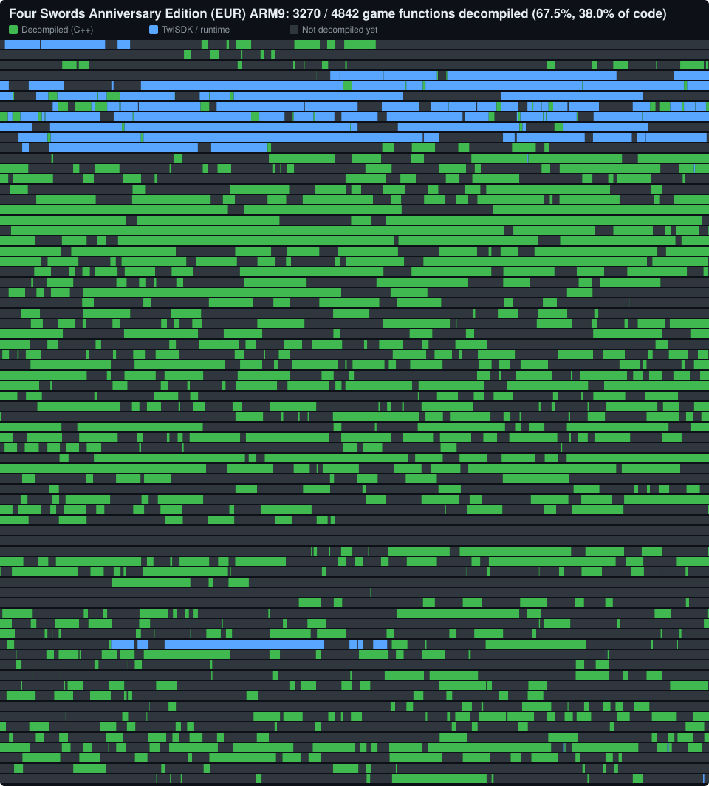

# The Legend of Zelda: Four Swords Anniversary Edition

A matching decompilation of *Four Swords Anniversary Edition* (DSiWare, `KQ9V`, Europe).

**This repository contains no game assets, code or ROMs.** You need your own copy of the game to build it.

| Version | File | SHA1 |
| --- | --- | --- |
| EUR | `extract/baserom_fsae_eur.nds` | `f151325756b6804d5c27e20ab8e70fe69239cbbf` |

## Status

Every ARM9 function in address order, sized by code size. Click the map for the interactive version (hover a block for
its name, address, size and source file; search by name). The map is regenerated by `tools/progress_map.py` on every
verified build.

The build reproduces the original ROM byte for byte. Decompiled functions are C++ in `src/` (original names and
signatures recovered from the Japanese debug build, see [Original names](#original-names)); everything else is still
delinked assembly.

| Part | State |
| --- | --- |
| ARM9 main, ITCM, DTCM | Analysed by dsd (`config/eur/arm9`), delinked and relinked with `mwldarm` |
| ARM7, ARM9i, ARM7i | Copied as binaries from the extract (dsd doesn't analyse them) |
| Overlays | The game has none |
| Assets | Extracted to `extract/eur/files` by dsd, repacked unchanged |

## Building

Prerequisites (Windows):
- Python 3.11+ with `requests` (`python -m pip install requests`)
- [Ninja](https://ninja-build.org/) on `PATH`
- The patched `tools/dsd.exe` (see [tools/patches](tools/patches/README.md)), `tools/mwccarm/` (from
  `http://decomp.aetias.com/files/mwccarm.zip`) and `objdiff-cli.exe` in the repo root

Steps:
1. Put your ROM at `extract/baserom_fsae_eur.nds`.
2. Put an ARM7 BIOS dump at `arm7_bios.bin` (needed to decrypt and re-encrypt the secure area). Known good:
   `24f67bdea115a2c847c8813a262502ee1607b7df`.
3. Run `python tools/configure.py eur`, then `ninja`.

`ninja` builds `fsae_eur.nds`, runs `dsd check` and verifies the SHA1. `ninja objdiff` writes `objdiff.json`.

The compiler flags in `tools/configure.py` are copied from the Spirit Tracks decomp and are a starting guess; the SDK
version (TwlSDK 5.5) points at CodeWarrior for DSi 1.2, which is what `MWCC_VERSION = "dsi/1.2"` selects.

## Known rough spots

- The Thumb code around `0x02083000..0x0208bcd4` (likely ported GBA code) is only roughly split into functions;
  dsd found many 2-byte "functions" there and `init` needed `--allow-unknown-function-calls`. A few symbols were fixed
  by hand (`func_0208bcd4`, three non-local `.L_` labels).
- `.rodata` isn't separated from `.text` yet.

## Original names

`config/eur/original_names.tsv` lists the original function names recovered from the Japanese debug build
(KQ9J, built with profiling hooks that reference each function's mangled name). `tools/debugsyms.py` strips the
hooks, matches the debug functions to retail ones (exact matches as anchors, then an order-preserving similarity
alignment) and was checked against the call graph. The original code was C++; static functions that share a name
across files get the owning file's prefix (`em09_seqSet`) or an address suffix. The debug ROM itself is not in the
repository.
